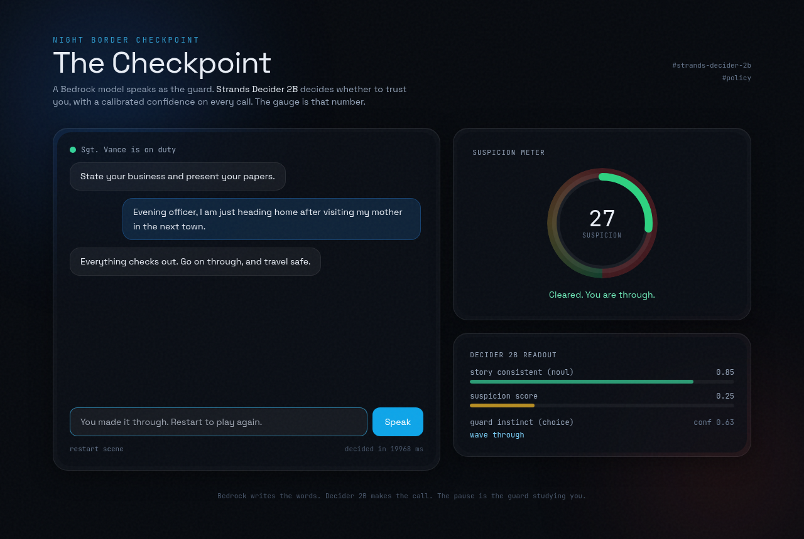

<div align="center">

# 🛂 The Checkpoint: a game decided by Strands Decider 2B

### Talk your way past an AI border guard. A Bedrock model speaks the guard's words. **Strands Decider 2B** makes every real decision, with a calibrated confidence on each call. The suspicion gauge you watch is that number.

[](https://strandsagents.com/blog/introducing-strands-decider/)
[](https://aws.amazon.com/bedrock/)
[](https://strandsagents.com)
[](https://aws.amazon.com/ai/generative-ai/nova/)
[](LICENSE)

`#strands-decider-2b` · `#policy`

[The Idea](#-the-idea) • [How It Works](#-how-it-works) • [The Decision](#-the-decision) • [Reusable Pattern](#-the-reusable-pattern) • [Getting Started](#-getting-started) • [FAQ](#-faq)

</div>

<div align="center">

</div>

---

<details>
<summary><b>📖 Table of Contents</b></summary>

- [The Idea](#-the-idea)
- [Why This Fits Decider](#-why-this-fits-decider)
- [How It Works](#-how-it-works)
- [The Decision](#-the-decision)
- [The Reusable Pattern](#-the-reusable-pattern)
- [Tech Stack](#-tech-stack)
- [Prerequisites](#-prerequisites)
- [Getting Started](#-getting-started)
- [Project Structure](#-project-structure)
- [What We Measured](#-what-we-measured)
- [Troubleshooting](#-troubleshooting)
- [FAQ](#-faq)
- [License](#-license)

</details>

---

## 🎯 The Idea

Give a language model an NPC to play and it gets talked into anything. Builders who ship
LLM NPCs describe the same failure: a player types one clever sentence and the guard hands
over the key. The model is great at talking and bad at holding a firm, consistent line.

The Checkpoint splits those two jobs:

- **Amazon Bedrock (Nova Pro)** plays Sergeant Vance. It narrates, stays in character, and
  asks questions. This is the part LLMs are good at.
- **Strands Decider 2B** makes the actual ruling. Each turn it reads the whole situation
  and answers three typed questions with a calibrated confidence. It never writes a word.

The guard cannot decide to trust you on its own. A small, calibrated decision model does,
and because it is calibrated, the game acts on confident answers and makes the guard ask
another question when the model is unsure. The suspicion meter on screen is literally the
probability coming out of Decider 2B.

---

## 🧠 Why This Fits Decider

Strands Decider 2B is a decision model. It does not generate text. It picks between options
and rates things on a scale, returning a probability for every answer in a single forward
pass, in about 115 ms on a GPU. A trust ruling in a game is exactly that kind of problem:
not open-ended writing, a bounded judgement with a confidence attached.

- A yes/no question (`noul`): is the new statement consistent with earlier claims?
- A pick-one question (`choice`): wave them through, press, ask for papers, or raise the alarm?
- A rubric question (`score`): how suspicious is this, from calm to alarming threat?

All three in one call, because Decider reads the state once and each question only adds its
own tokens.

---

## 🔧 How It Works

```
┌──────────────────────────────────────────────────────────────────────────┐
│                                                                            │
│   🧑 Traveler line        🛂 The Checkpoint engine         🧠 Models        │
│                                                                            │
│   ┌──────────────┐     ┌──────────────────────────┐   ┌────────────────┐ │
│   │ "I am just   │────▶│ build state:              │──▶│ Decider 2B     │ │
│   │  heading     │     │  scene + claims so far    │   │ score / noul / │ │
│   │  home"       │     │  + latest line            │   │ choice (+conf) │ │
│   └──────────────┘     └────────────┬─────────────┘   └───────┬────────┘ │
│                                     │                         │          │
│                                     ▼                         ▼          │
│                        ┌──────────────────────────┐   suspicion meter    │
│                        │ update meter from the     │   (the probability)  │
│                        │ calibrated numbers,        │                      │
│                        │ decide outcome:            │   ┌────────────────┐ │
│                        │  passed / caught / alarm   │──▶│ Bedrock Nova   │ │
│                        │  / continue                │   │ Pro narrates   │ │
│                        └──────────────────────────┘   │ the guard line │ │
│                                                        └────────────────┘ │
└──────────────────────────────────────────────────────────────────────────┘
```

The engine (`app/game.py`) makes one Decider call per turn, updates a running suspicion
meter from the calibrated numbers, and decides the outcome. Bedrock then turns that ruling
into one in-character line. The web UI shows the gauge move and the raw readout in real time.

---

## 🎲 The Decision

Every turn, Decider 2B answers these three typed questions about one state:

| Key | Type | Question | Reads back as |
|-----|------|----------|---------------|
| `suspicion` | `score` | How suspicious is the traveler's behaviour and story? | expected level, calm to alarming |
| `consistent` | `noul` | Does the latest statement agree with earlier claims? | P(consistent) |
| `reaction` | `choice` | How should the guard respond right now? | wave through / press / demand document / raise alarm, with confidence |

The engine turns that into an outcome:

- **passed**: low suspicion, consistent, and a confident wave through
- **caught**: the story contradicts an earlier claim, the guard presses hard
- **alarm**: suspicion crosses the line, or a confident raise alarm
- **continue**: anything the model is not sure about, so the guard asks one more question

That last line is the whole point of a calibrated model. Act when sure, ask a human (here,
ask the traveler) when not.

---

## ♻️ The Reusable Pattern

The hackathon asks every entry to ship a decision pattern another builder can drop in. Ours
is **`SuspicionGate`**, a Strands `InterventionHandler` that puts a Decider decision in front
of any agent's committing tools.

```python
from strands import Agent
from app.decider_client import DeciderClient
from patterns.suspicion_gate import SuspicionGate

decider = DeciderClient("http://127.0.0.1:8000")   # a running `strands-decider serve`

gate = SuspicionGate(
    decider,
    act_tools={"issue_refund", "close_account"},    # only gate committing tools
    get_state=lambda event: build_state(event),     # what the model reads
    alarm_threshold=0.70,
    grounded_threshold=0.50,
    min_confidence=0.45,
)

agent = Agent(tools=[...], interventions=[gate])
```

It runs on `before_tool_call` and returns one typed action: `Proceed` when confident and
grounded, `Guide` to send the turn back with feedback when the action is not grounded or the
model is unsure, and `Deny` for a hard stop. Full write up and adaptation guide in
[`patterns/README.md`](patterns/README.md).

Why a decision model and not a second LLM call here: one forward pass, a real confidence on
every answer, and several questions about one state for almost the price of one. Cheap enough
to sit on every tool call, which is a place an LLM call cannot afford to live.

---

## 🛠️ Tech Stack

| Component | Technology |
|-----------|-----------|
| 🧠 Decision model | [Strands Decider 2B](https://strandsagents.com/blog/introducing-strands-decider/) (`strands-decider-2B-qwen3.5-v1-2610`) served locally |
| 🗣️ Narrator | [Amazon Nova Pro](https://aws.amazon.com/ai/generative-ai/nova/) (`us.amazon.nova-pro-v1:0`) via Bedrock |
| 🤖 Agent framework | [Strands Agents SDK](https://strandsagents.com) with the intervention system |
| 🖥️ UI | FastAPI + a single page with GSAP and an animated SVG gauge |
| 🐍 Runtime | Python 3.11, `httpx`, `boto3` |

---

## 📋 Prerequisites

| # | Requirement | Details |
|---|---|---|
| 1 | **Python 3.11+** | `python3.11 --version` |
| 2 | **~5 GB disk + ~8 GB RAM** | the Decider weights are about 4.6 GB; on an 8 GB box add swap (see Troubleshooting) |
| 3 | **AWS credentials** | with `bedrock:InvokeModel` for Nova Pro, so the guard can speak |
| 4 | **Amazon Nova Pro access** | enable `amazon.nova-pro-v1:0` in the Bedrock console (`us-east-1`) |

> The guard narration is optional. With no AWS access the game still runs end to end using
> built in fallback lines; Decider 2B still makes every decision.

---

## 🚀 Getting Started

```bash
git clone https://github.com/simplynadaf/the-checkpoint.git
cd the-checkpoint

python3.11 -m venv .venv && source .venv/bin/activate
pip install -r requirements.txt

# 1. start the decision model (first run downloads ~4.6 GB of weights)
bash scripts/run_decider.sh 8000

# 2. start the web game
bash scripts/run_ui.sh 8080

# 3. open http://127.0.0.1:8080 and talk your way through
```

Prefer the terminal? Run the scripted scenarios instead:

```bash
python -m tests.test_scenarios   # an honest traveler and a lying one
python -m tests.test_unit        # offline logic tests, no model or AWS needed
```

---

## 📁 Project Structure

```
the-checkpoint/
├── README.md
├── requirements.txt
├── PROGRESS.md                 # the build log
├── patterns/
│   ├── suspicion_gate.py       # the reusable InterventionHandler (the asset)
│   └── README.md               # drop-in guide + the typed question set
├── app/
│   ├── decider_client.py       # client for `strands-decider serve` + noul/choice/score builders
│   ├── game.py                 # turn loop, player-claims state, meter, outcomes
│   └── guard_agent.py          # Strands Agent on Bedrock Nova Pro (guard persona + tools)
├── ui/
│   ├── server.py               # FastAPI backend bridging the engine + Bedrock to the browser
│   └── static/index.html       # the cinematic single page with the live suspicion gauge
├── scripts/
│   ├── run_decider.sh          # start the Decider server, detached
│   ├── run_ui.sh               # start the web UI, detached
│   └── play.sh                 # run the scripted terminal scenarios
├── tests/
│   ├── test_unit.py            # offline logic tests (fake decider)
│   ├── test_game.py            # scripted run against the live model
│   └── test_scenarios.py       # honest vs lying traveler
└── docs/
    ├── ARTICLE.md              # the Builder Center write up
    ├── DEMO_SCRIPT.md          # the sub three minute demo shot list
    └── ui-initial.png          # README screenshot
```

---

## 📊 What We Measured

Measured on a CPU only box (no GPU), serving `strands-decider-2B-qwen3.5-v1-2610`:

- A three question call takes about 11 seconds warm on CPU (prefix cache helps after the
  first call). On a GPU the model answers in roughly 115 ms, so the same game is instant on
  the right hardware. The CPU pause became the guard studying you, which fits the scene.
- An honest traveler clears on turn one: suspicion about 0.25, consistency about 0.85, a
  confident wave through.
- A lying traveler's reaction confidence collapses as the contradictions pile up
  (0.63 to 0.29 to 0.17), and the suspicion meter climbs past the alarm line. The model's
  confidence, not a hand written rule, carries the signal.

This is an experimental model used for experimentation, exactly as intended. The honest
finding: the `suspicion` score and the confidence collapse are the strong signals; the raw
`consistent` yes/no is softer on subtle contradictions at this size. Good to know, and good
to design around.

---

## 🐛 Troubleshooting

| Problem | Fix |
|---------|-----|
| Decider server gets `Killed` on start | The fp32 CPU load needs about 9 GB. On an 8 GB box add swap: `sudo fallocate -l 8G /swapfile && sudo chmod 600 /swapfile && sudo mkswap /swapfile && sudo swapon /swapfile`. The load peak spills to swap, resident settles near 4 GB. |
| First call is slow or times out | The model loads on the first request. `scripts/run_decider.sh` waits for it; give it up to a couple of minutes on CPU. |
| Guard lines are generic | Bedrock is unreachable, so the game fell back to templated lines. Check AWS credentials and that Nova Pro is enabled in `us-east-1`. Decider still decides either way. |
| Everything feels slow | You are on CPU. Run the Decider server on a GPU host and point `DECIDER_URL` at it for about 115 ms decisions. |

---

## ❓ FAQ

<details>
<summary><b>Does the LLM decide anything?</b></summary>

No. Bedrock writes the guard's words and asks questions. Every trust ruling, wave through,
press, or alarm, comes from Strands Decider 2B's calibrated answers. The engine only turns
those numbers into an outcome.
</details>

<details>
<summary><b>Why a decision model instead of just asking the LLM to judge?</b></summary>

Three reasons. It is one forward pass with no text generation, so it is cheap. It returns a
calibrated confidence on every answer, which LLM inference APIs do not expose. And it answers
several questions about one state almost for free. That combination lets a decision sit in a
place a second LLM call would be too slow and costly to live.
</details>

<details>
<summary><b>Is the suspicion meter real or scripted?</b></summary>

Real. The meter is derived directly from the `score` and `noul` probabilities the model
returns each turn. The raw numbers are shown live in the readout panel next to the gauge.
</details>

<details>
<summary><b>Can I reuse the decision pattern in my own agent?</b></summary>

Yes, that is the point. Copy `patterns/suspicion_gate.py`, pass your committing tool names
and a function that builds the state, and attach it as an intervention. See
[`patterns/README.md`](patterns/README.md).
</details>

---

## 📝 License

Apache-2.0, see the [LICENSE](LICENSE) file. The Strands Decider models are Apache-2.0 at
their pinned commits.

---

<div align="center">

**Bedrock writes the words. Decider 2B makes the call.**

*Built for the Agent Experience Hackathon: Strands Decider. `#strands-decider-2b` `#policy`*

</div>
